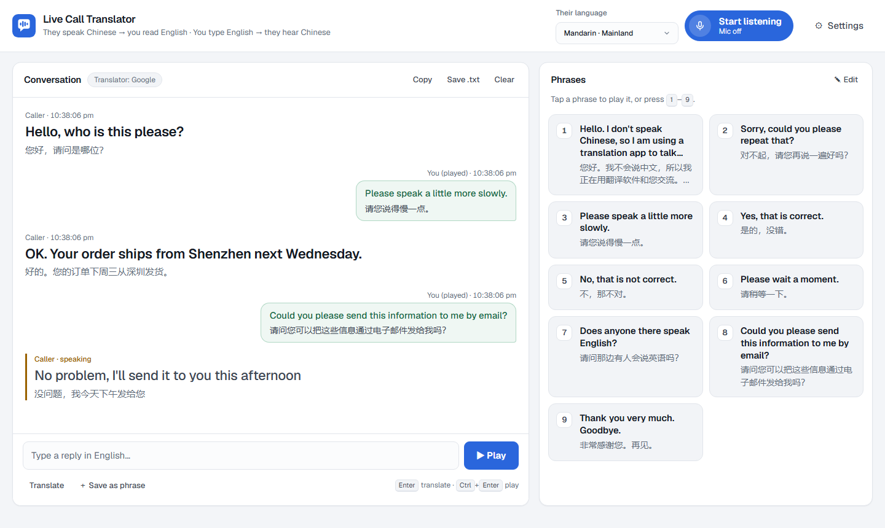

# Live Call Translator

A zero-dependency web app for phone calls on speaker with someone who speaks Chinese.

- **They speak Chinese → you read English**, live, on screen.
- **You type English (or pick a saved phrase) → it's translated to Chinese → press Play** and your laptop speaker says it to the caller.

It runs entirely in the browser using free services. There are no API keys, accounts or build steps.

**Live demo:** https://live-call-translator.netlify.app (open in Chrome or Edge). Add `#demo` to the URL to see a sample conversation.

<picture>
  <source media="(prefers-color-scheme: dark)" srcset="docs/screenshot-dark.png">
  
</picture>

## Features

- Live Chinese speech recognition with a rolling English translation while the caller is still talking
- Mandarin (Mainland / Taiwan) and Cantonese (Hong Kong)
- Saved phrases as big tap-to-play tiles (or keys `1`–`9`), with an edit mode for reordering and JSON export/import
- A mic button that shows what the app is doing (listening, paused while playing, blocked) and pulses with your mic level
- A playback bar with progress and a large Stop button (`Esc`)
- A "↩ Means:" back-translation under every phrase, so you can check the meaning before you play it
- Browser voices (Edge's "Natural" voices sound best) or the free Google online voice as a fallback
- The mic pauses automatically while the app is speaking, so it doesn't transcribe itself
- Copy the call transcript or save it as `.txt`
- Works on phones, follows your light/dark system setting, and supports keyboard and screen-reader use

## Requirements

- **Google Chrome or Microsoft Edge.** Firefox and Safari don't support the continuous Web Speech recognition this app needs.
- An internet connection (speech recognition and translation run on online services).
- [Node.js](https://nodejs.org/) 18 or newer, only if you want to run it locally.

## Run locally

```bash
git clone https://github.com/soham24/live-call-translator.git
cd live-call-translator
npm start
```

Then open http://localhost:5173. To use a different port, set `PORT`, for example `PORT=8080 npm start`.

Shortcuts that also open the browser for you:

- **Windows:** double-click `scripts/start.bat`
- **macOS / Linux:** run `./scripts/start.sh`

The page has to be served over `http://localhost` or HTTPS. Browsers won't reliably grant microphone access to a page opened as a `file://`.

## Deploy

The app is a static site in `public/`, so any static host works.

**Netlify:** `netlify.toml` already points at `public/`. The live demo is linked to this repo, so every push to `main` deploys automatically. For your own fork, connect the repo in the Netlify dashboard or run `netlify deploy --prod`.

**GitHub Pages / Vercel / Cloudflare Pages:** set the publish directory to `public/`. No build command is needed.

## How to use on a call

1. Put the phone on speaker next to your laptop. The laptop mic hears the caller, and the phone mic hears the laptop speaker.
2. Pick the caller's language (Mandarin Mainland / Taiwan, or Cantonese).
3. Click **Start listening** and allow the microphone.
4. Reply by tapping a phrase tile (or keys `1`–`9`), or type in the reply box under the transcript. `Enter` translates, `Ctrl+Enter` translates and plays, `Esc` stops playback.
5. **Save .txt** keeps a transcript of the call.

### Tips

- Try **Settings → Test voice** before the call.
- Keep "Pause mic while playing" on so the app doesn't transcribe its own Chinese audio.
- The listener is set to Chinese, so stay quiet while the caller talks. Your English would come out as nonsense Chinese text.
- Phrases are stored in your browser's `localStorage`. Click **Edit**, then **Export / Import**, to back them up or move them to another browser.

## How it works

| Purpose | Service |
|---|---|
| Speech → text (Chinese) | Browser [Web Speech API](https://developer.mozilla.org/docs/Web/API/Web_Speech_API) |
| Translation | Google Translate public endpoint, with [MyMemory](https://mymemory.translated.net/) as a fallback |
| Text → speech | Browser `speechSynthesis` voices, or the Google Translate voice |

The Google Translate and voice endpoints are unofficial and can be rate-limited under heavy use. This is fine for personal use on calls, but don't build a high-traffic service on top of them.

## Project structure

```
.
├── public/            # The app (what gets deployed)
│   ├── index.html
│   ├── app.js         # Recognition, translation, speech, phrases, settings
│   ├── style.css      # Theme tokens (dark + light) and layout
│   ├── favicon.svg, apple-touch-icon.png, og.png
├── docs/              # README screenshots
├── scripts/
│   ├── start.bat      # Windows launcher
│   └── start.sh       # macOS / Linux launcher
├── server.js          # Tiny zero-dependency static server for local use
├── netlify.toml       # Netlify config (publishes public/)
└── package.json
```

## Privacy

Audio is processed by your browser's speech recognition service (Google for Chrome, Microsoft for Edge). Recognised text and your typed phrases are sent to the translation services listed above. The interface font loads from Google Fonts. Nothing is sent to any server run by this project. Settings and phrases stay in your browser.

## Contributing

Issues and pull requests are welcome. See [CONTRIBUTING.md](CONTRIBUTING.md).

## License

[MIT](LICENSE)
